# How unimind-router connects to Unimind

This document describes how the client (`unimind-router`) connects to and exchanges data with
**Unimind**. It covers the client's components, the protocol layers, how connectivity and
authentication work (direct, or through an Azure Bastion tunnel), tool calls, jLens, tunnel
recovery and liveness.

Unimind is treated as one service behind a TLS endpoint. Its internals are out of scope here.

Each diagram is shown as Mermaid (it renders on GitHub and Azure DevOps) and also available as a
JPG in [`diagrams/`](diagrams/) (Mermaid sources: `diagrams/*.mmd`).

> Addresses and names are placeholders. The real values for a deployment go in `router.json`
> ([CONFIGURE.md](CONFIGURE.md)).

---

## 1. Components

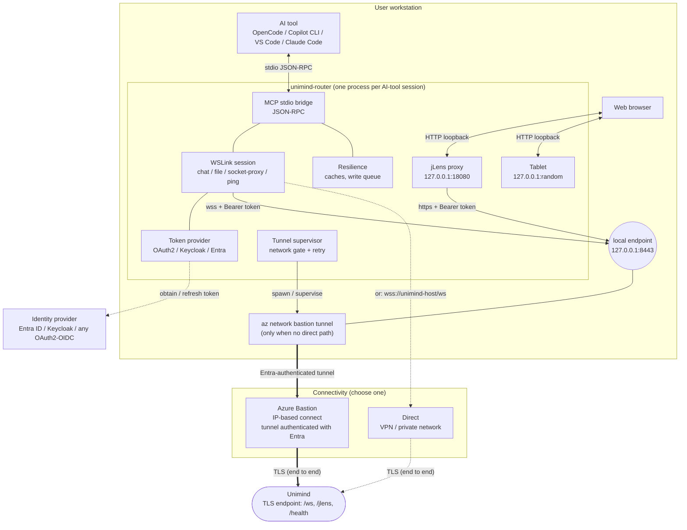

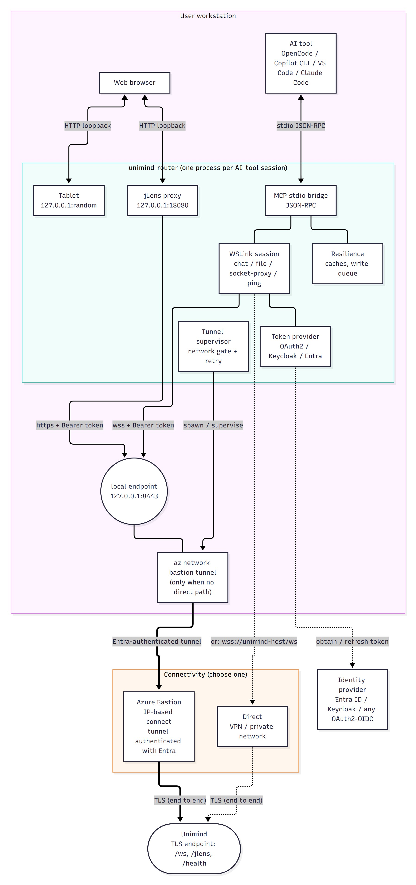
*JPG: [diagrams/01-components.jpg](diagrams/01-components.jpg) - source: [diagrams/01-components.mmd](diagrams/01-components.mmd)*

| Part | Role |
|---|---|
| **AI tool** | Starts the router as a local MCP server over stdio |
| **unimind-router** | One process per AI-tool session. Bridges MCP to a WSLink session, obtains tokens, keeps the connection alive, and serves jLens and the tablet on loopback. |
| **Identity provider** | Issues the bearer token the router presents to Unimind: **Entra ID**, **Keycloak**, or any **OAuth2/OIDC** provider |
| **Connectivity** | **Direct** (VPN or private network) when Unimind is reachable, or the router's built-in **Azure Bastion tunnel** when it isn't |
| **Unimind** | One TLS endpoint: `/ws` (session), `/jlens` (web UI), `/health` |

**Two separate authentications**

1. **Tunnel** (only when there's no direct path): Azure Bastion admits the tunnel based on the
   **Entra** identity of `az login` and its Azure RBAC. This is an Azure requirement.
2. **Unimind:** every WebSocket and jLens request carries `Authorization: Bearer <token>`. The
   token can come from **OAuth2 / Keycloak** (a token file or environment variable) or **Entra**
   (`az`, MSAL, managed identity). Unimind validates it. The router never makes authorization
   decisions itself.

All router listeners bind to `127.0.0.1` only. Several sessions share one tunnel (the first router
opens it, the others reuse the healthy local port) and one jLens port.

---

## 2. Protocol layers

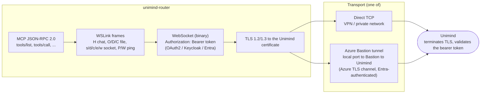

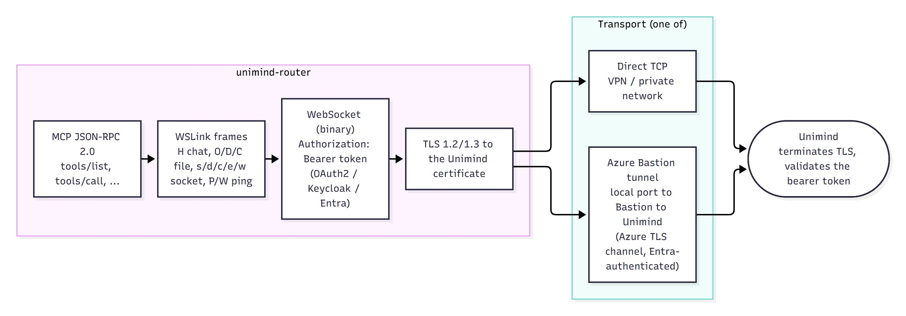
*JPG: [diagrams/02-protocol-stack.jpg](diagrams/02-protocol-stack.jpg) - source: [diagrams/02-protocol-stack.mmd](diagrams/02-protocol-stack.mmd)*

- **End to end (router ↔ Unimind):** TLS. Inside it is a WebSocket carrying **WSLink** frames,
  and inside those are MCP JSON-RPC messages.
- **Bastion path only:** `az network bastion tunnel` carries that TLS stream inside Azure's own
  authenticated channel. Bastion relays it and can't read it.
- **Port 3389:** Bastion's IP-based connect only allows remote ports 22 and 3389, so Unimind also
  serves its TLS endpoint on 3389 for this path. It's TLS, not RDP.

**WSLink frame types used by the router**

| Byte | Name | Purpose |
|---|---|---|
| `H` | chat | One MCP JSON-RPC message (request, response or notification) |
| `O` / `D` / `C` / `S` / `V` / `A` / `N` / `Z` | file | Resumable file transfer (open, data, close, seek/resume, verify, ack/nak, done) |
| `s` / `d` / `c` / `e` / `w` | socket proxy | Reverse port-forward and SSH-agent channels (open, data, close, error, window credit). Off unless enabled. |
| `P` / `W` | ping / pong | L2 heartbeat |
| `R` / `Q` | ready | Session readiness |

**Endpoints the client uses**

| Endpoint | Use |
|---|---|
| `GET /ws` (WebSocket upgrade) | The session (long-lived) |
| `/jlens…` | jLens web UI and API, through the local proxy |
| `GET /health` | Liveness |

---

## 3. Connecting

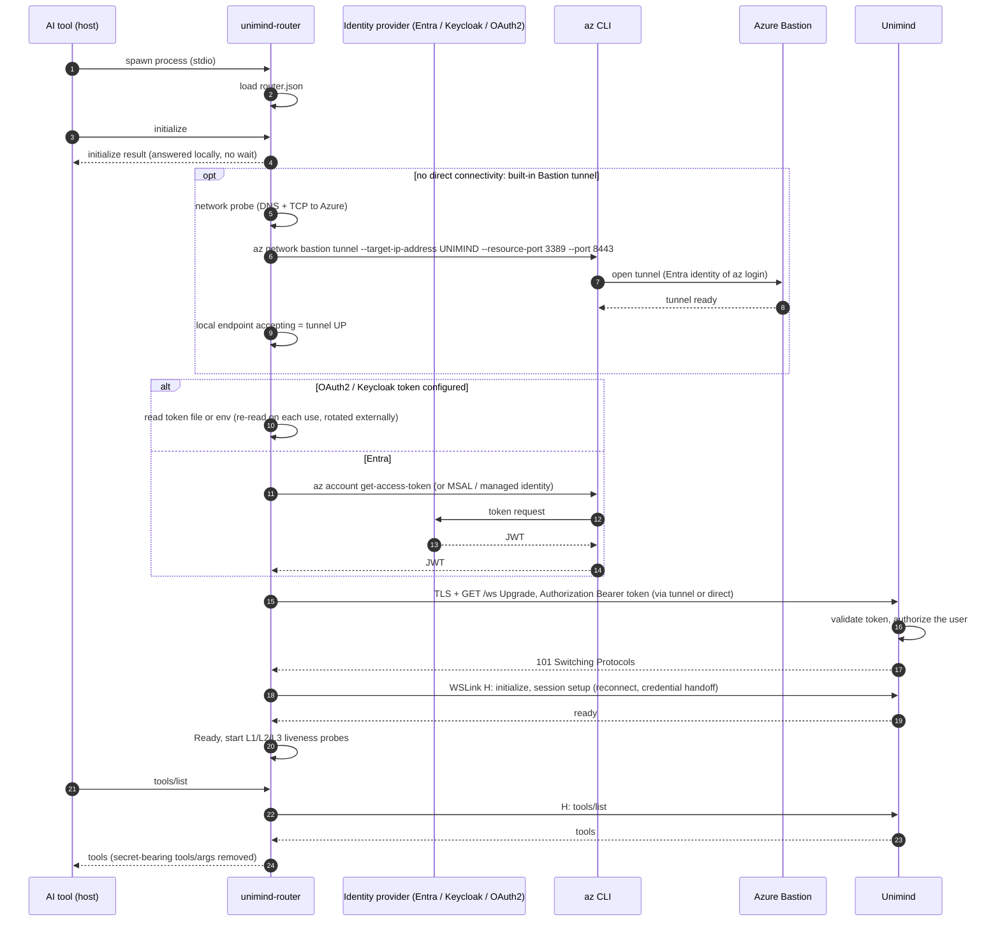

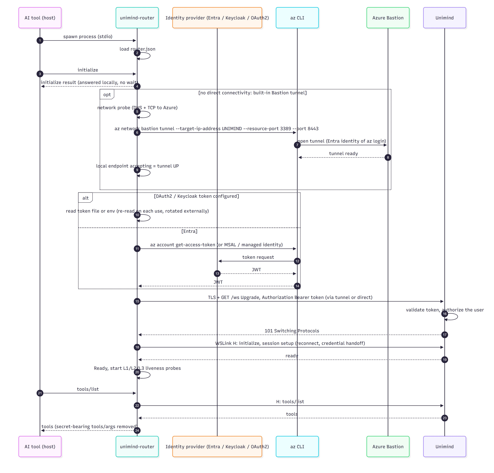
*JPG: [diagrams/03-connect-sequence.jpg](diagrams/03-connect-sequence.jpg) - source: [diagrams/03-connect-sequence.mmd](diagrams/03-connect-sequence.mmd)*

- **`initialize` is answered locally**, so the AI tool never waits on the network to start.
- **Tunnel (optional):** started only when configured, after a network probe confirms Azure is
  reachable. The tunnel counts as up when the local endpoint accepts connections.
- **Token:** an explicitly configured OAuth2/Keycloak token (`UNIMIND_OAUTH_TOKEN_FILE`,
  `KEYCLOAK_TOKEN_FILE`, `UNIMIND_OAUTH_TOKEN`, `KEYCLOAK_ACCESS_TOKEN`) takes precedence over
  Entra. Token files are re-read on every use, so an external tool can refresh them. Expired JWTs
  are skipped.
- **Credential handoff:** the user's GitHub/Copilot token and optional API keys go **directly to
  the session**, never through the AI model. The tool that does this is hidden from `tools/list`.
- **Restart detection:** if Unimind restarts, the router notices and re-handshakes automatically.

---

## 4. A tool call

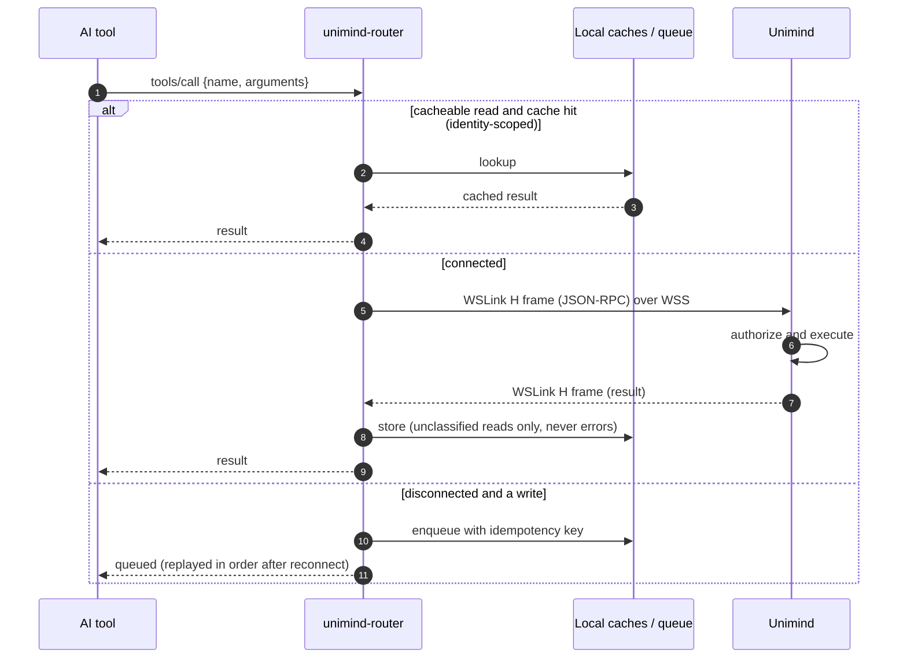

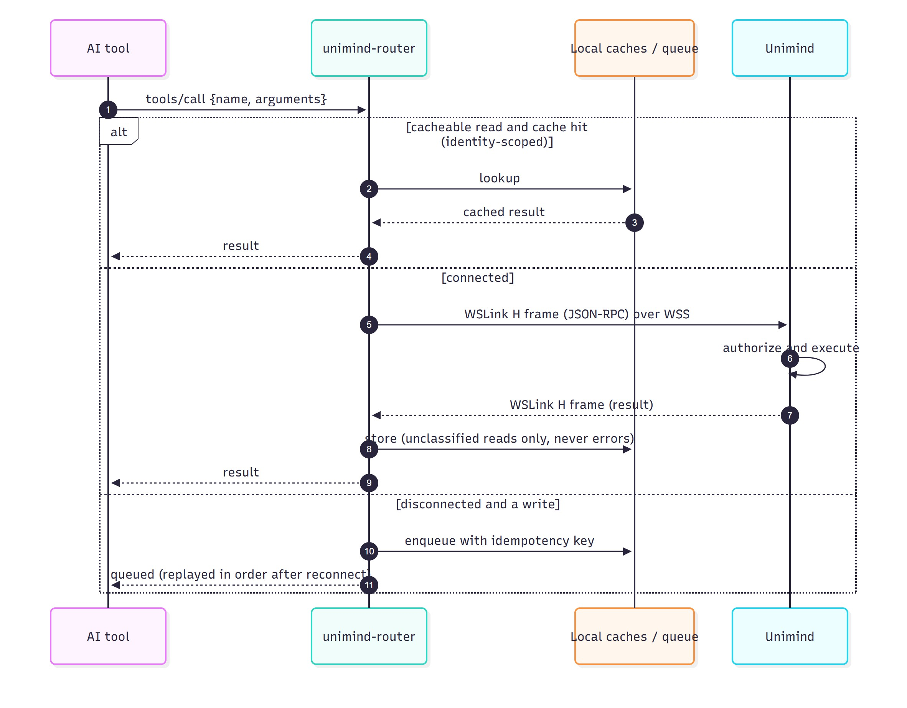
*JPG: [diagrams/04-tool-call.jpg](diagrams/04-tool-call.jpg) - source: [diagrams/04-tool-call.mmd](diagrams/04-tool-call.mmd)*

- **Reads** may be served from a local cache scoped to the signed-in identity. Errors and
  classified results are never written to disk.
- **Writes made while disconnected** are queued with an idempotency key and replayed in order
  after reconnect.
- **Unimind** decides what the user is allowed to do. The router only forwards the request.

---

## 5. jLens through the local proxy

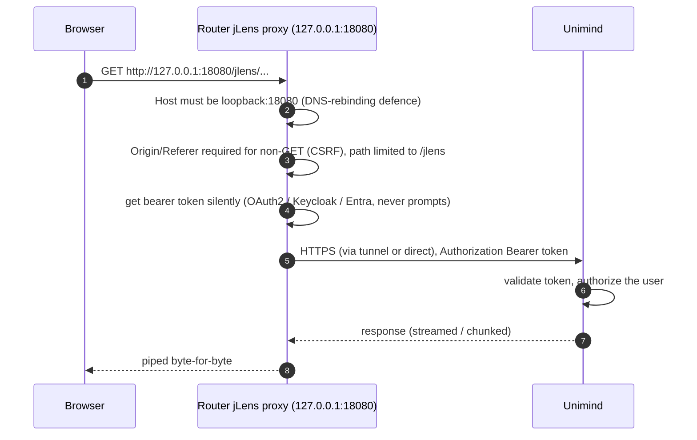

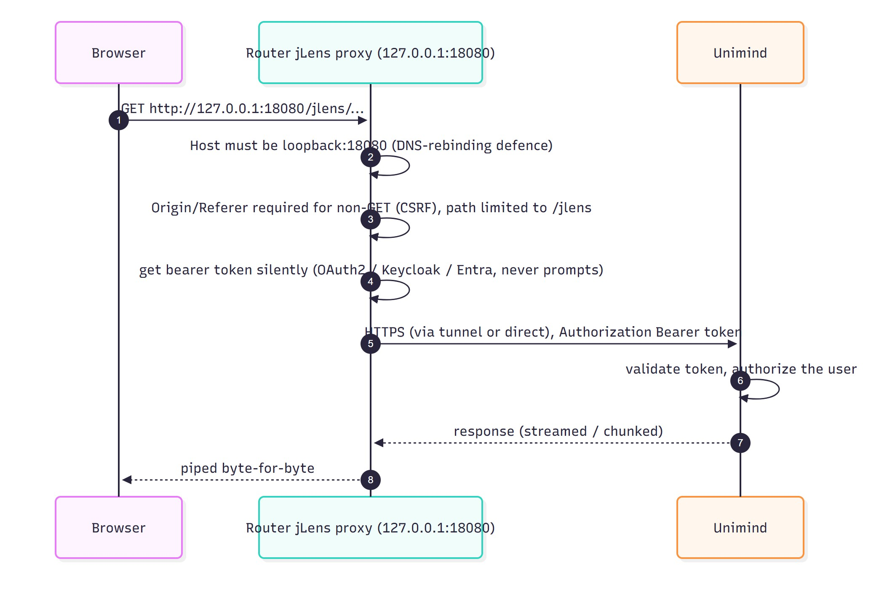
*JPG: [diagrams/05-jlens.jpg](diagrams/05-jlens.jpg) - source: [diagrams/05-jlens.mmd](diagrams/05-jlens.mmd)*

The browser never holds a token. The proxy:
- **Accepts loopback requests only:** strict `Host` check against DNS rebinding, and
  `Origin`/`Referer` required for state-changing requests (CSRF).
- **Adds the bearer token silently.** It never shows a sign-in prompt.
- **Streams the response back unchanged.**

The **tablet** listener (a random loopback port per session) uses the same loopback and `Host`
protections. It serves local pages only.

---

## 6. Tunnel supervision and recovery (Bastion path)

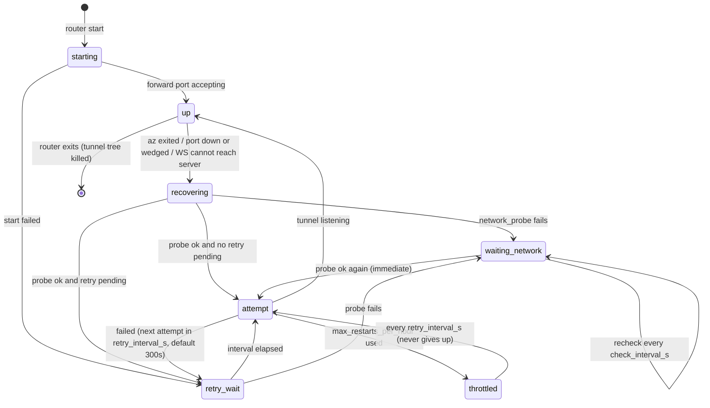

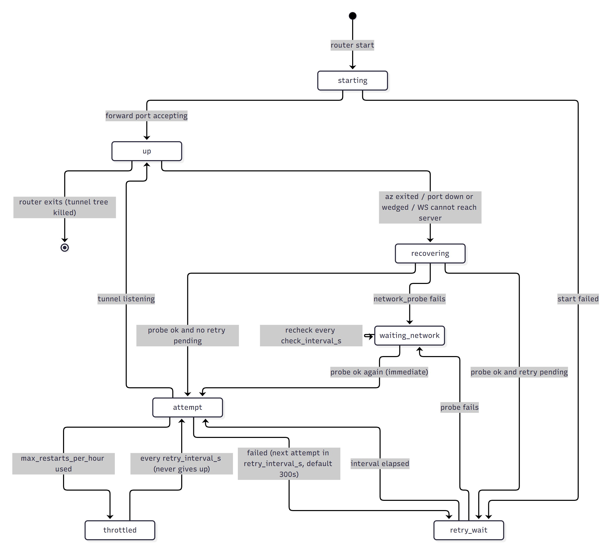
*JPG: [diagrams/06-tunnel-states.jpg](diagrams/06-tunnel-states.jpg) - source: [diagrams/06-tunnel-states.mmd](diagrams/06-tunnel-states.mmd)*

| Setting (`router.json` → `tunnel`) | Default | Effect |
|---|---|---|
| `check_interval_s` | 15 | How often tunnel health is checked |
| `network_probe` | `management.azure.com:443` | Gate before every attempt. If it fails, no attempt is made (`waiting_network`). |
| `retry_interval_s` | 300 | Wait after a failed attempt while the network is up (`retry_wait`) |
| `max_restarts_per_hour` | 20 | Beyond this, attempts continue every `retry_interval_s` (`throttled`). The router never gives up. |

- **Two triggers, one gate:** the health loop and the WebSocket reconnect loop both go through
  the same gated recovery.
- **Clean-up:** the `az` process tree belongs to the router and is cleaned up even if the router
  crashes (Windows Job Object).
- **Other processes:** the router never kills a process it didn't start.

---

## 7. Liveness

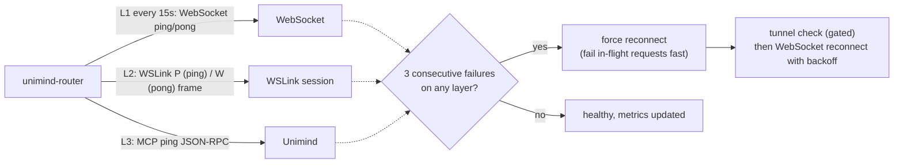

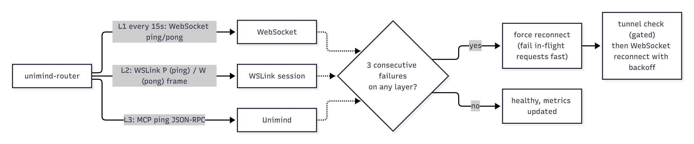
*JPG: [diagrams/07-liveness.jpg](diagrams/07-liveness.jpg) - source: [diagrams/07-liveness.mmd](diagrams/07-liveness.mmd)*

| Layer | Probe | Detects |
|---|---|---|
| L1 | WebSocket ping/pong | Dead network path or wedged tunnel |
| L2 | WSLink `P`/`W` | Broken session on a live socket |
| L3 | MCP `ping` | Unimind not answering |

Probes run every 15 s by default. After 3 consecutive failures the router reconnects, and
in-flight requests fail immediately instead of hanging. Live values are at
`http://127.0.0.1:18080/__router/metrics`.

---

## 8. Security summary (client side)

| Concern | Control |
|---|---|
| Reaching Unimind | Direct (VPN or private network), or Azure Bastion: Entra identity + Azure RBAC, no public endpoint needed |
| Authenticating to Unimind | A bearer token from OAuth2 / Keycloak / Entra on every session and jLens request, validated by Unimind |
| Data in transit | TLS end to end to Unimind. On the Bastion path it also travels inside Azure's encrypted channel. |
| Server certificate | Verified when `UNIMIND_CA_CERT` is set. Otherwise unverified **only** for loopback (tunnel) endpoints, with a warning. |
| Secrets | Tokens are held in memory only (token files are read, never written) and never logged. Credentials are handed off out-of-band and hidden from the model. |
| Local listeners | `127.0.0.1` only, `Host`/`Origin` checks, concurrency caps, timeouts |
| Local data | Caches are identity-scoped. Classified results never go to disk. Uploads are limited to allowed folders, and secrets folders are always refused. |
